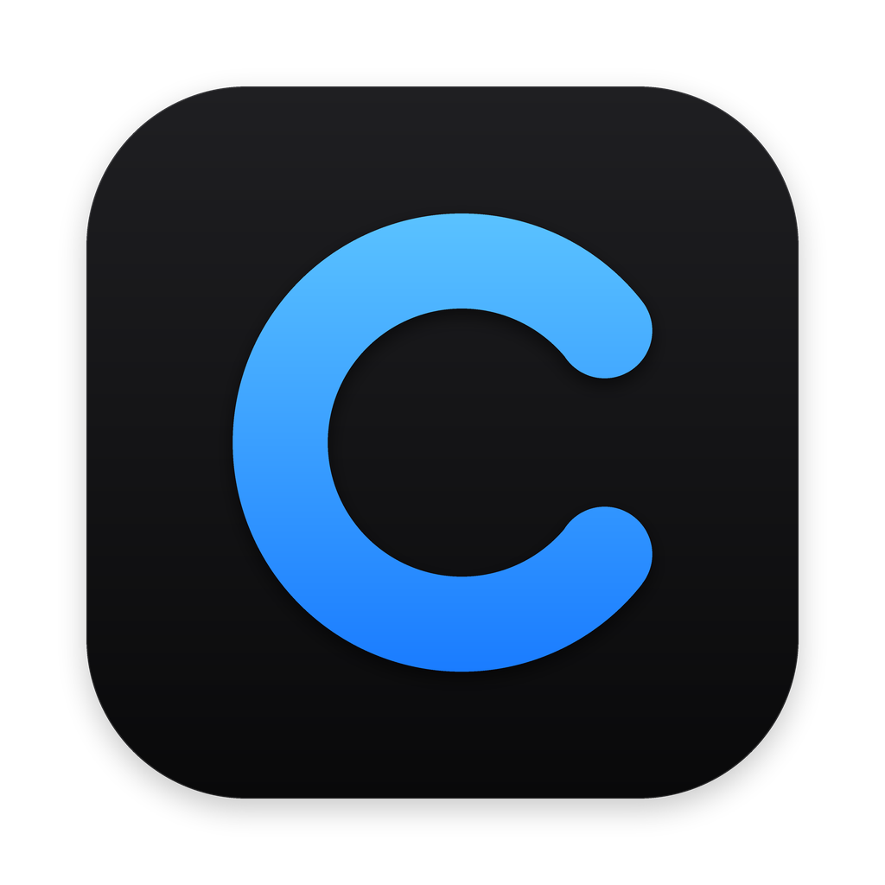

<div align="center">



# Customers

**Бесплатная CRM со встроенным поиском клиентов для macOS и Windows**<br>
компании и контакты · сделки и воронки · задачи · отчёты · импорт из Excel · поиск клиентов в открытых источниках

[](https://github.com/xop1tt/Customers-App/releases/latest)
[](https://github.com/xop1tt/Customers-App/releases)
[](https://github.com/xop1tt/Customers-App/wiki/Установка)
[](https://github.com/xop1tt/Customers-App/wiki/Установка)
[](desktop)
[](desktop/src)
[](desktop/src-tauri)
<br>
[](https://github.com/xop1tt/Customers-App/actions/workflows/tests.yml)
[](https://github.com/xop1tt/Customers-App/actions/workflows/desktop.yml)
[](https://github.com/xop1tt/Customers-App/actions/workflows/cloud.yml)
[](LICENSE)

[**⬇️ Скачать (macOS и Windows)**](https://github.com/xop1tt/Customers-App/releases/latest) ·
[**📖 Документация (Wiki)**](https://github.com/xop1tt/Customers-App/wiki) ·
[**🐞 Сообщить о проблеме**](https://github.com/xop1tt/Customers-App/issues/new)

</div>

---

Customers — CRM для небольшой команды или одного специалиста: компании и контакты, сделки на доске этапов, задачи
на сегодня, лента клиента, отчёты по воронке, импорт клиентов из CSV и Excel. Работать можно одному на своём
компьютере или вместе с коллегами в общем рабочем пространстве (Workspace) с ролями и правами.

В CRM встроен поиск клиентов. Customers ищет потенциальных клиентов в открытых источниках: RSS-ленты (биржи, новостные и тематические ленты),
публичные Telegram-каналы, сообщества VK и организации из OpenStreetMap. Он отбирает подходящие записи, оценивает
каждую по понятным правилам и складывает в удобную таблицу на вашем компьютере (Mac или ПК с Windows). Искать можно
под любую нишу: источники, ключевые слова и исключения вы задаёте сами. Набор правил оценки по умолчанию настроен
на заказы на разработку (сайты, Telegram-боты, приложения, автоматизация, CRM), это лишь один из сценариев. **Всё бесплатно навсегда**: без подписок, пробных периодов, платных API и AI-сервисов.

## ✨ Возможности

| | |
|---|---|
| 🤝 **Клиенты и сделки** | Компании, контакты, сделки на доске этапов с суммами, несколько воронок, причины проигрыша, свои поля и коллекции |
| ✅ **Задачи и «Сегодня»** | Задачи со сроками и напоминаниями, экран дел на сегодня и просроченных, лента клиента со всей историей |
| 📊 **Отчёты** | Воронка и конверсия, выигранные суммы, средний цикл сделки, причины проигрыша, итоги по ответственным |
| 📥 **Импорт из таблиц** | Мастер импорта CSV и Excel: сопоставление колонок, предпросмотр, дубликаты, отмена импорта |
| 👥 **Команда** | Общий Workspace, приглашения, роли и права, сообщения и уведомления |
| 🔎 **Поиск в один клик** | Кнопка «Найти лиды» (⌘R / Ctrl+R) или автопроверка по расписанию, в том числе в фоне из трея |
| 📡 **Четыре вида источников** | RSS/Atom-ленты, Telegram-каналы, VK-сообщества, OpenStreetMap с проверкой сайтов организаций |
| 🎯 **Понятная оценка** | 0–100 баллов и причины: тематика, явный запрос, бюджет, срочность, спам (правила по умолчанию рассчитаны на заказы на разработку). Факты отдельно от предположений |
| 🧹 **Без дублей и мусора** | Дедупликация по ID и отпечатку текста, домена, телефона. Исключения: домены, телефоны, email, ваша база клиентов из CSV |
| 🗂 **Удобная работа с лидами** | Три панели, фильтры, поиск, избранное, архив, заметки, история, черновик первого обращения |
| 📞 **Связь прямо из карточки** | Звонок по `tel:` (FaceTime, iPhone, «Связь с телефоном»), письмо через почтовую программу или напрямую по SMTP (Gmail, Яндекс, Mail.ru, iCloud и любой сервер) |
| ☁️ **Синхронизация (по желанию)** | Вход по почте и данные на нескольких компьютерах, в том числе Mac и Windows вместе, через ваш бесплатный проект Supabase |
| 💾 **Данные под контролем** | База шифруется (SQLCipher), ежедневные резервные копии, выгрузка копий на облачные диски (Google Диск, Dropbox, OneDrive, Яндекс Диск, pCloud, MEGA, WebDAV/Nextcloud; на macOS и в iCloud Drive), экспорт в CSV и JSON, отправка в Bitrix24, Notion и через вебхук (Make, n8n, Zapier) |
| 🔄 **Автообновление** | Новая версия ставится из приложения со сверкой SHA-256 |
| 🎨 **Одно приложение на двух системах** | Tauri 2: интерфейс на React и ядро на Rust одинаковы на macOS и Windows. Тёмный плоский дизайн «Flat Dark», значок в трее, работа в фоне и автозапуск, масштаб интерфейса и акцентный цвет |
| 🔒 **Приватность** | Своих серверов и аналитики нет: у локальной учётной записи лиды не покидают ваш компьютер. Секреты лежат в Связке ключей macOS и в защищённом хранилище DPAPI на Windows |

## 🚀 Быстрый старт

Готовые файлы лежат на странице [последнего релиза](https://github.com/xop1tt/Customers-App/releases/latest): один релиз содержит установщики для обеих систем и файлы `.sha256` для проверки.

### 🍎 macOS (12 Monterey и новее)

1. Скачайте `Customers-vX.Y.Z-macOS.dmg`.
2. Откройте dmg и перетащите **Customers** в «Программы».
3. При первом запуске: правый клик по приложению → **Открыть** → **Открыть**
   (сборка без платной подписи Apple, macOS спросит один раз).
4. Создайте учётную запись, добавьте в «Источниках» свои Telegram-каналы, RSS-ленты или город и нажмите **«Найти лиды»** (⌘R).

Универсальная сборка: Apple Silicon и Intel. Обновления ставятся из самого приложения («Customers → Проверить обновления…»).

### 🪟 Windows (10 версии 1809 и новее, 11; x64)

1. Скачайте `Customers-vX.Y.Z-Windows-x64-Setup.exe`.
2. Запустите установщик (права администратора не нужны; среда WebView2 уже есть в Windows 11 и в обновлённой Windows 10, при её отсутствии установщик подскажет, где взять).
   Если SmartScreen пишет «Windows защитила ваш компьютер», нажмите **Подробнее → Выполнить в любом случае**
   (установщик без платной подписи Microsoft).
3. Создайте учётную запись, добавьте источники и нажмите **«Найти лиды»**.

Данные лежат в `%LOCALAPPDATA%\Customers` и при обновлении и удалении по умолчанию сохраняются. Приложение само предлагает новую версию.
Подробнее: [Wiki → Установка](https://github.com/xop1tt/Customers-App/wiki/Установка), [desktop/README.md](desktop/README.md), сборка из исходников: [Wiki → Разработка и сборка](https://github.com/xop1tt/Customers-App/wiki/Разработка-и-сборка).

Обе версии работают с одним облачным аккаунтом и одним форматом экспорта, поэтому можно пользоваться и Mac, и Windows.

## 📖 Документация

Подробная документация переехала в **[Wiki](https://github.com/xop1tt/Customers-App/wiki)**:

| Пользователям | Продвинутым |
|---|---|
| [Установка](https://github.com/xop1tt/Customers-App/wiki/Установка) | [Разработка и сборка](https://github.com/xop1tt/Customers-App/wiki/Разработка-и-сборка) |
| [Работа с приложением](https://github.com/xop1tt/Customers-App/wiki/Работа-с-приложением) | [Интеграции приложения](https://github.com/xop1tt/Customers-App/wiki/Интеграции-приложения) |
| [Источники](https://github.com/xop1tt/Customers-App/wiki/Источники) | [Импорт из таблиц](https://github.com/xop1tt/Customers-App/wiki/Импорт-из-таблиц) |
| [Оценка и фильтры](https://github.com/xop1tt/Customers-App/wiki/Оценка-и-фильтры) | [Безопасность и конфиденциальность](https://github.com/xop1tt/Customers-App/wiki/Безопасность-и-конфиденциальность) |
| [Учётные записи и облако](https://github.com/xop1tt/Customers-App/wiki/Учётные-записи-и-облако) | [Ограничения и планы](https://github.com/xop1tt/Customers-App/wiki/Ограничения-и-планы) |
| [Резервные копии и экспорт](https://github.com/xop1tt/Customers-App/wiki/Резервные-копии-и-экспорт) · [Экспорт в CRM](https://github.com/xop1tt/Customers-App/wiki/Экспорт-в-CRM) | [Настройка облака Supabase](docs/cloud-setup.md) · [устройство облака](docs/cloud.md) |
| [Интеграции: диски, почта, звонки](https://github.com/xop1tt/Customers-App/wiki/Интеграции-приложения) | [Тестирование](https://github.com/xop1tt/Customers-App/wiki/Тестирование) · [Аудит источников](docs/research.md) |
| [Обновления и отчёты о сбоях](https://github.com/xop1tt/Customers-App/wiki/Обновления-и-отчёты-о-сбоях) | [Приложение: исходники](desktop/README.md) |
| [Частые проблемы](https://github.com/xop1tt/Customers-App/wiki/Частые-проблемы) | |

## 📡 Откуда берутся лиды

| Источник | Доступ | Что находит |
|---|---|---|
| RSS-ленты (FL.ru и любые другие) | бесплатно | записи лент: описание, бюджет, ссылка |
| Telegram-каналы | бесплатно | посты публичных каналов с контактами |
| VK-сообщества | бесплатный ключ | посты открытых сообществ |
| OpenStreetMap + проверка сайтов | бесплатно | организации без сайта или с устаревшим сайтом |

Kwork, Habr Freelance, Яндекс Карты, 2ГИС и поисковые системы не подключены: бесплатно и в рамках правил их
использовать нельзя. Причины: [Wiki → Источники](https://github.com/xop1tt/Customers-App/wiki/Источники#что-не-подключено-и-почему).

## 🧱 Из чего состоит

```
desktop/      приложение для macOS и Windows (Tauri 2): src/ интерфейс (React, TypeScript), src-tauri/ ядро (Rust:
              поиск, шифрованная база, учётные записи, облако, диски, почта), installer/ установщик для Windows
supabase/     необязательное облако: миграции Postgres, Edge Functions, тесты
tests/        проверки репозитория (pytest): workflow, release-check, иконки
docs/         облако и аудит источников
wiki/         исходники Wiki: публикуются в Wiki workflow после слияния в main
```

## 📦 Релизы и проверки

Один workflow `Release` (`.github/workflows/release.yml`) по тегу `vX.Y.Z` или `vX.Y.Z.W` (или вручную из Actions) параллельно
собирает dmg для macOS и установщик для Windows и создаёт **один** GitHub Release с обоими файлами и контрольными суммами SHA-256.
Если любая сборка упала, релиз не создаётся. Проверки на каждый PR: `Tests` (проверки репозитория), `Desktop`
(типы и тесты интерфейса, тесты ядра на Linux, macOS и Windows, сборка приложения для обеих систем), `Cloud`, CodeQL.

## 🔒 Безопасность

Уязвимость? Не создавайте публичный issue, напишите через **Security → Report a vulnerability**.
Подробности: [SECURITY.md](SECURITY.md).

## 📄 Лицензия

Customers распространяется по лицензии **Functional Source License 1.1 с переходом в Apache 2.0** (FSL-1.1-ALv2).
Исходный код открыт для изучения. Приложение можно бесплатно использовать, изменять и распространять для любых
целей, кроме конкурирующего коммерческого продукта или сервиса. Через два года после выхода каждая версия становится
доступна по лицензии Apache 2.0. Это лицензия с доступным исходным кодом, а не open source в смысле OSI.
Версии до перехода на FSL распространялись по PIBUL 1.0. Полный текст: [LICENSE](LICENSE).

<div align="center">
<sub>© 2026 xop1tt · <a href="LICENSE">FSL-1.1-ALv2</a></sub>
</div>
